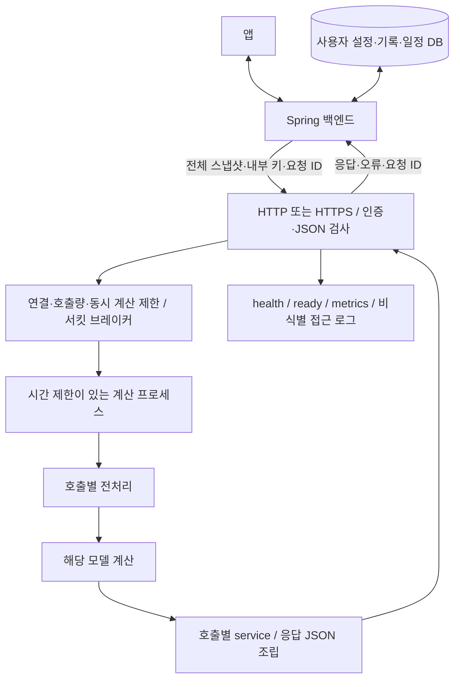

# SLEEP 통합 AI 서버

Spring이 사용자별 전체 입력 스냅샷을 전달하면, 호출별 전처리와 모델 계산을 **시간 제한이 있는 별도 프로세스**에서 수행해 응답합니다. AI는 백엔드 재조회·DB 저장을 하지 않습니다. 통합 실행은 Python 3.12와 AI-06 의존성을 사용합니다.

**[통합 서버 명세](docs/INTEGRATED_SERVER_SPEC.md)** · **[현재 문제별 처리 결과](dummy/docs/REMEDIATION.md)** · [이전 코드 검토](dummy/docs/SERVER_REVIEW.md)

## 호출 목록

[백엔드 연결 명세와 전체 호출 JSON](ai_server/BACKEND_INTEGRATION.md)

| 모델 | 설계·기반 자료 | 계산 흐름 |
| --- | --- | --- |
| AI-02 | [평상시 수면](ai_server/ai_02/README.md) | [흐름도](ai_server/ai_02/FLOW.md) |
| AI-03 | [벼락치기 수면·공부](ai_server/ai_03/README.md) | [흐름도](ai_server/ai_03/FLOW.md) |
| AI-04 | [수면 부족과 회복](ai_server/ai_04/README.md) | [흐름도](ai_server/ai_04/FLOW.md) |
| AI-05 | [일정 분류](ai_server/ai_05/README.md) | [흐름도](ai_server/ai_05/FLOW.md) |
| AI-06 | [집중 모드](ai_server/ai_06/README.md) | [흐름도](ai_server/ai_06/FLOW.md) |

| 번호 | 경로 | 역할 | 계약 |
| --- | --- | --- | --- |
| AI-01 | GET /ai/v1/health | 인증 없는 liveness·버전 | [명세](docs/AI-01_BACKEND_CONTRACT.md) |
| AI-02 | POST /ai/v1/plan/tonight | 평상시 수면 추천 | [명세](docs/AI-02_BACKEND_CONTRACT.md) |
| AI-03 | POST /ai/v1/plan/exam-sleep | 시험 전 수면·공부 배치 추천 | [명세](ai_server/ai_03/docs/BACKEND_SPEC.md) |
| AI-04 | POST /ai/v1/sleep-debt/calculate | 수면 회복 | [명세](docs/AI-04_BACKEND_CONTRACT.md) |
| AI-05 | POST /ai/v1/insights/risks | 일정 일괄 분류 | [명세](docs/AI-05_BACKEND_CONTRACT.md) |
| AI-06 | POST /ai/v1/plan/focus-sleep | 집중 모드 수면 추천 | [명세](docs/AI-06_FOCUS_BACKEND_CONTRACT.md) |

AI-03은 Spring 연동 계약 `SLEEPSYNC_EXAM_SNAPSHOT_V1`과
계산용 계약 `EXAM_SLEEP_MINIMAL_V1`, `EXAM_SLEEP_BACKEND_V1`을 받습니다.
Spring 호출에 필요한 필드는 [연동 인계서](ai_server/ai_03/docs/SPRING_HANDOFF.md)에 정리되어 있습니다.

## 구조



[호출별 모델까지 포함한 상세 흐름](docs/SERVER_FLOW.md)


| 패키지 | 설명 |
| --- | --- |
| [ai_01](ai_server/ai_01/README.md) | 가벼운 헬스체크 |
| [ai_02](ai_server/ai_02/README.md) | [Sleep_plan](ai_server/ai_02/Sleep_plan/README.md) + [Fatigue](ai_server/ai_02/Fatigue/README.md) |
| [ai_03](ai_server/ai_03/README.md) | 시험 전 수면·공부 추천 |


## 실행

AI_INTERNAL_KEY를 공백 없는 출력 가능한 ASCII 비밀값으로 환경에 주입한 뒤 SLEEP에서 실행합니다. 키를 코드/Git/앱에 저장하지 않습니다.

```powershell
python -m pip install -r ai_server/ai_06/requirements.txt
python -B -X utf8 -m ai_server --host 127.0.0.1 --port 8000
```


- `GET /ai/v1/health`: 인증 없는 liveness, 기존 응답 유지.
- `GET /ai/v1/ready`: 내부 인증 필요. AI-02~06 시작 추론과 SHA-256 리소스 무결성 확인 결과.
- `GET /ai/v1/metrics`: 내부 인증 필요. 요청 수·지연 합계/최대·현재 연결·거절·타임아웃·회로 상태.
- CLI는 요청 ID·등록 경로·상태·처리시간의 JSON 접근 로그를 출력하고 입력 원문/키는 기록하지 않습니다.

다른 머신에서 접근하려면 내부망 바인딩·방화벽을 구성해야 합니다. HTTPS는 `SLEEP_TLS_CERT`와 `SLEEP_TLS_KEY` 또는 `--tls-cert/--tls-key`로 인증서·키를 지정합니다. 인증서와 내부 키는 운영 환경에서 주입하며 저장소에 넣지 않습니다. [배포·재시작·CPU/메모리 제한](deploy/README.md)과 [운영 설정](docs/INTEGRATED_SERVER_SPEC.md)을 따르세요. 실제 서비스 머신에 배포하거나 Spring을 변경한 것은 아닙니다.

## 입력·결과의 핵심 차이

- AI-01은 전체 모델 readiness를 검증하지 않습니다. 파일 배포 후 각 계산 호출도 확인해야 합니다.

## 검증과 예제

```powershell
python -B -m ai_server.resources
python -B -X utf8 tools/check_backend_contract.py http://127.0.0.1:8000/ai/v1
```
과거 연구·테스트·데모 자료는 [dummy](dummy)에 있습니다.

## AI-03 시험 수면 추천

준비 상태, 시험 성격, 일정과 수면 기록으로 주수면·낮잠·공부 배치를
비교합니다. 평소 취침·기상과 가까운 안을 우선 비교하고, 마지막
주수면은 분 단위로 탐색합니다. 기존 요청 DTO와 모델 버전
`exam-sleep-workload-2.0.0`을 사용합니다.

[모델 README](ai_server/ai_03/README.md) · [백엔드 계약](docs/AI-03_BACKEND_CONTRACT.md) ·
[OpenAPI](docs/AI-03_OPENAPI.json) · [정규화 요청 예제](docs/examples/ai07-request.json) ·
[백엔드 요청 예제](docs/examples/ai07-backend-request.json)
