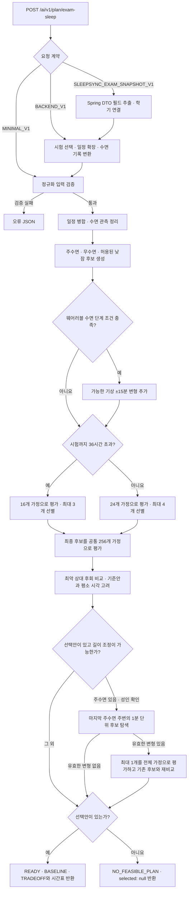
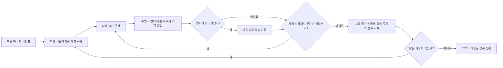

# AI-03 계산 플로우

## 후보 평가 안에서 반복되는 계산

- **시간표 구성**은 시험 준비·통학을 포함한 고정 일정을 보존한다. 수면 직후의 빈 시간은 기상 버퍼로 표시하고, 60분 미만 고정 일정 사이 공강의 나머지는 휴식으로 표시한다.
- **시뮬레이션**은 각 단계에 들어온 후보마다 반복한다. 최종 후보를 평가할 때는 선별 단계에서 계산한 점수를 재사용한다. 시간 구간은 기본 15분이며 수면·일정 경계에서 추가로 나뉜다.
- **결과**는 요청 시각부터 시험 시작까지의 시간표다. 유효한 계획이 없으면 `NO_FEASIBLE_PLAN`과 `selected: null`을 반환한다. 잘못된 요청은 별도 오류 응답을 반환한다.

[계산 근거](DESIGN.md) · [백엔드 명세](BACKEND_SPEC.md)
