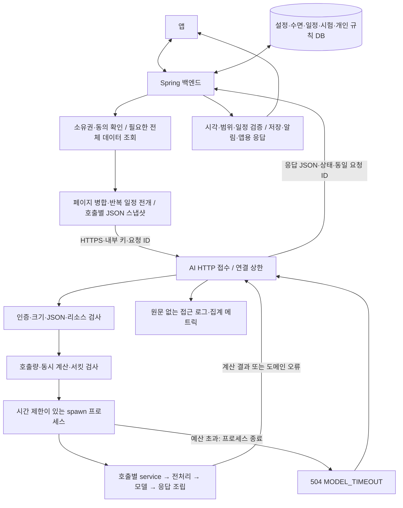
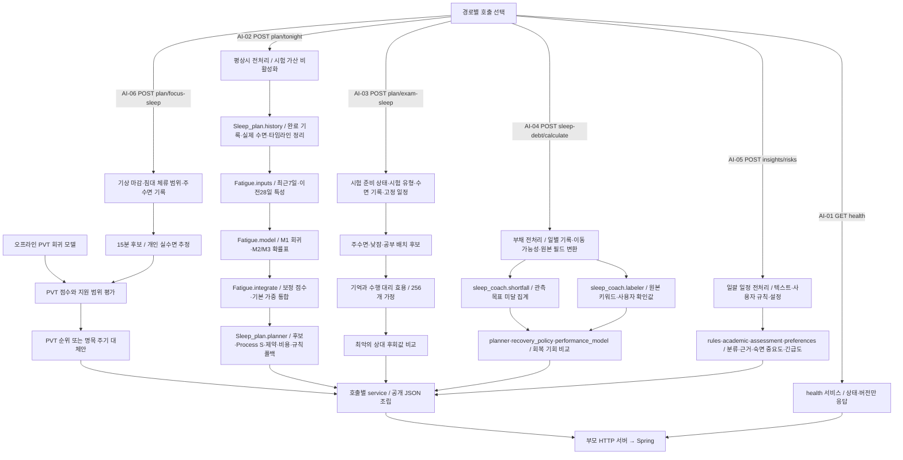
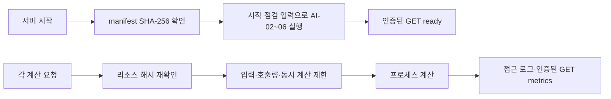

# 백엔드 ↔ AI 서버 전체 흐름

## 전체 요청·응답

AI는 DB나 백엔드로 데이터 보완 요청을 하지 않습니다. 모델에 전달할 데이터는 요청에 완성되어 있어야 합니다. 응답 형식은 서비스가 만들고, 실제 DB planId/slotId 발급은 Spring의 책임입니다.

## AI 내부: 호출별 계산

AI-02~06의 전처리·모델·응답 조립은 같은 요청의 자식 프로세스에서 실행됩니다. AI-03 벼락치기 추천과 AI-06 집중 모드는 각각의 모델로 계산합니다.

## 운영 상태 흐름

health는 liveness이고, ready는 현재 배포 리소스와 시작 추론 결과입니다. 임의의 모든 사용자 입력이 성공한다는 의미는 아닙니다. 400/422·429·503·504의 처리와 재시도 기준은 [서버 명세](INTEGRATED_SERVER_SPEC.md)를 따릅니다.

